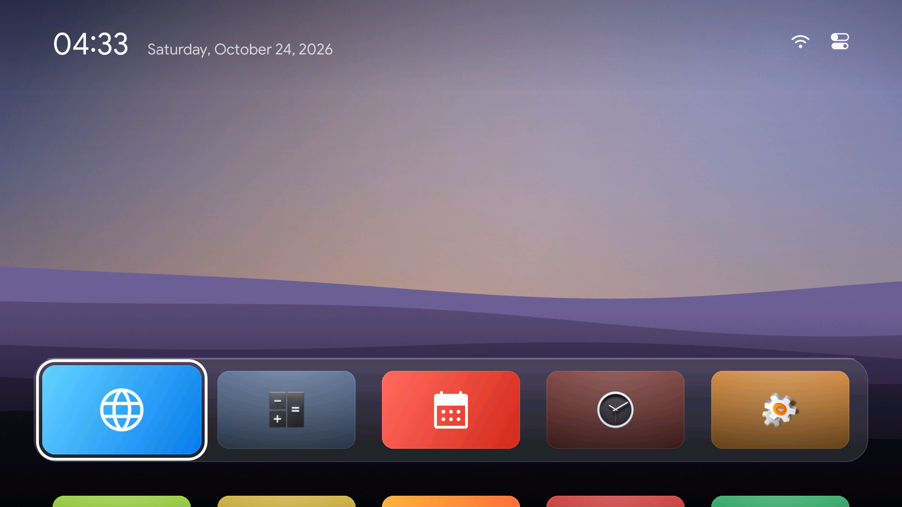
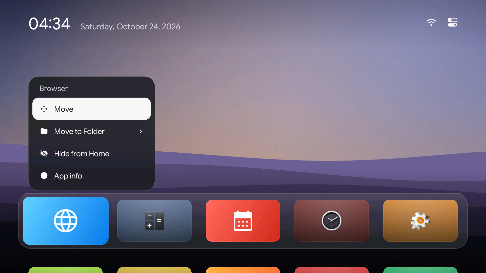
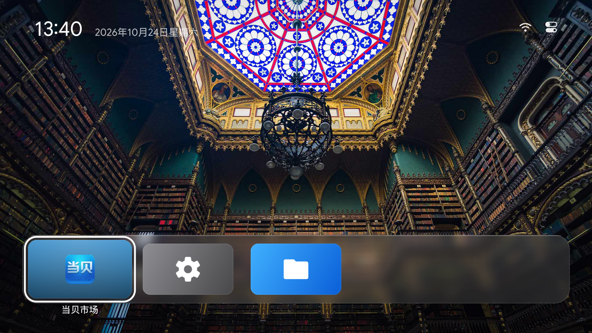
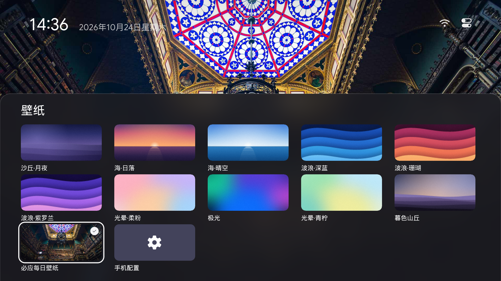
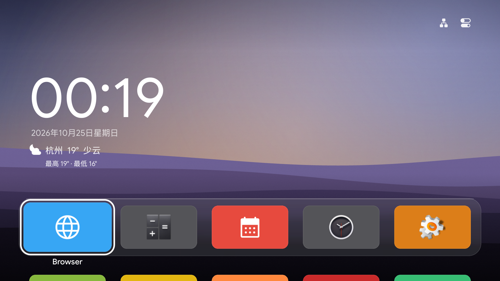

# aerial-tv-legacy

**给 Android 4.3 老电视的一块干净桌面。**

向 [pengchujin/aerial-tv](https://github.com/pengchujin/aerial-tv) 致敬。这个项目延续 Aerial 的 tvOS 风格、壁纸和遥控器交互，为无法运行 Compose 的 **Android 4.3 / API 18** 重新实现了 Java / Canvas 版本。

这是独立的兼容项目，并非 Aerial 官方版本。新系统请优先使用原版 Aerial。

[下载 APK](https://github.com/KawaiiHachimi/aerial-tv-legacy/releases/latest) · [原版 Aerial](https://github.com/pengchujin/aerial-tv)

## 界面



| 长按整理 | 控制中心 |
| --- | --- |
|  |  |

以上三张为 Android 4.3 模拟器的原生 1920×1080 屏幕截图，保留模拟器的应用列表。

下面为 1.4.0 版 S40 Air 真机必应壁纸与“只显示选中的”应用名称，1920×1080 原始截图；1.4.1 起卡片底色改为纯色：



壁纸图片版权归原摄影者 / Bing 内容提供方；示例为应用运行截图，图片不会作为内置资源发布。

## 卡片样式

普通应用使用统一规则，不按第三方 APP 包名做特殊处理：

- 有合格的 TV 横幅时优先显示横幅；API18 缺少 banner 字段时直接从 APK 的 manifest 查找。方形图标不会被当成横幅拉伸。
- 没有横幅时保留 APK 图标的颜色和形状，按统一尺寸居中，搭配从图标取色的通用纯色背景。
- 系统功能应用恢复 Aerial 原版的颜色体系：取 `TileArt.kt` 中每类渐变的中间色作为纯色底（设置灰色、文件管理蓝色）。矢量图标参考 `GlyphPaths.kt`，不绘制渐变和额外投影。文件管理与信号源属于旧 LeTV 的功能扩展映射。

必应每日选项已加入缓存预览，更新成功后刷新；手机配置页也会显示当天图片：



## 功能

- 无广告、无推荐流，以已安装应用为中心。
- 遥控器方向键导航、焦点缩放、按压反馈和边缘回弹；尽量减少卡片与文字阴影。
- 应用移动、文件夹、隐藏与恢复、应用信息，以及交由系统确认的卸载。
- 控制中心：网络和系统设置入口、音量、个性化、屏保；有线网络 / Wi-Fi / 离线状态图标。
- 15 款内置壁纸、必应每日壁纸、手机扫码上传照片；断网保留已缓存图片。
- 应用名称三档：全部显示、仅选中、全部隐藏；修复第一排开启玻璃底板时选中名称不显示。
- 手机配置：局域网二维码网页，可预览 / 选择内置壁纸、选择必应、传图、设置名称 / 时钟 / 焦点 / 屏保。
- 天气：手机选择城市，首页显示天气图标、当前气温和今日高低温；支持中文城市、离线短期缓存和大小时钟布局。
- 可配置空闲时间的时钟屏保；唤醒按键不会误启动应用。
- 内置 Google Sans Regular / Medium 静态字体；缺少的汉字使用系统中文字体回退。
- 布局和偏好保存在本地；后台不运行持续动画。

## 兼容与边界

本项目主要面向 Android 4.3 老电视，最低 API 18，不依赖 AndroidX 或 Compose。必应与天气 HTTPS 使用 API18 兼容的 Conscrypt 2.5.3，包含 ARMv7 / x86 native 库。发布包保持 DEX 035 和 APK v1 签名。

已在 Android 4.3 x86 模拟器验证基础交互，并在 LeTV S40 Air 真机安装测试壁纸：必应 HTTPS 实际下载、照片裁切与无效图片保护、手机接口和三档名称绘制均通过。信号源的空桌面列表崩溃已定位并补齐 EUI 初始化；用户确认可用“上 → 右”返回桌面。物理 HDMI 输入画质、背光和其它机型仍需分别验证。

画面 / 亮度入口交给系统设置。部分 EUI 固件只允许 UID1000 调整主音量，普通桌面身份的音量请求会被拒绝；此版本保留显示和标准接口，尚未解决该机型的音量权限限制。

尚未移植原版的航拍视频、自动升级及家长密码。此仓库不包含电视固件、厂商 APK、设备密钥或用户数据。

## 天气

在「个性化 → 天气」打开手机配置，扫码后点顶部的「天气」。搜索城市并选择结果，即可在首页显示天气；也可关闭显示。天气默认关闭，不根据 IP 猜测位置，不请求定位权限。中国城市使用原版 Aerial 的 GeoNames 城市表，海外城市与拼音搜索使用 Open-Meteo 地理编码。

- 数据来自 [Open-Meteo](https://open-meteo.com/)，显示当前气温、晴雨图标和今日最高 / 最低温。日夜图标由天气数据决定。
- 桌面可见时每小时检查更新；失败后间隔至少 10 分钟重试，可在手机页面手动刷新。复用现有时钟回调，不增加后台常驻服务。
- 断网保留最近 3 小时的数据，并标记缓存；过期或系统时间回拨后隐藏读数，避免把旧天气当成当前天气。切换城市会清除旧城市读数。
- 天气 HTTPS 与必应共享兼容客户端，公共 CA 根证书按域名隔离，保留证书和域名校验。天气根证书来源与指纹见 `app/assets/weather-ca/README.txt`。



上图为本机 Android 4.3 模拟器的原生 Canvas 渲染，杭州仅为明确选择的测试城市；不代表电视位置。天气联网、手机配置和两种时钟布局已在模拟器验证，尚未安装本版到 S40 Air 真机。

## 壁纸与手机配置

在「个性化 → 壁纸」选择必应每日，或在「个性化 → 手机配置」打开二维码。手机和电视连接同一局域网，用手机浏览器扫码。无需外部服务器、账号或云端照片存储。

- 支持 JPEG / PNG / WebP，上传上限 8 MB；解码后限制尺寸，按屏幕比例居中裁切。电视保存最新一张手机照片，上传成功立即应用。
- 必应每天在回到桌面时检查更新；网络失败保留上次图片，没有缓存时使用内置壁纸。可在手机页面手动刷新，并查看图片版权说明。
- 配置页面展示 15 款内置壁纸预览；链接带随机令牌，仅接受局域网请求。退出桌面即关闭服务，二维码窗口关闭后最多保留 5 分钟；窗口持续打开最多 15 分钟。
- Bing 使用 HTTPS、Conscrypt 和随 APK 提供的官方公共 CA 根证书；仅用于 Bing 连接，保留证书与域名校验，不修改系统信任库。证书来源与指纹见 `app/assets/bing-ca/README.txt`。
- 目前是每日一张必应图片和最新一张手机照片；原版的历史图库、多照片轮播与视频壁纸尚未完整移植。

## 安装

从 Releases 下载 `AerialLegacy.apk`，通过电视自带的 APK 安装方式或 ADB 安装：

```bash
adb install -r AerialLegacy.apk
adb shell am start -n app.aerial.legacy/.MainActivity
```

按主页键，在系统允许的情况下选择 Aerial 并设为默认桌面。部分国产电视对 HOME 有自己的限制，不能保证只装 APK 就能接管；不要为此直接停用原厂桌面。

包名：`app.aerial.legacy`。覆盖更新需要相同签名。自己编译的开发包与 Releases 可能使用不同签名。

## 构建

需要 JDK 17+、Python 3、`zip`、Android SDK 的 API18 平台和 build-tools 36.0.0。

```bash
# 使用 Android SDK 的 sdkmanager 安装构建依赖
sdkmanager "platforms;android-18" "build-tools;36.0.0"

export ANDROID_SDK_ROOT=/path/to/android-sdk
export JAVA_HOME=/path/to/jdk
./build.sh
```

输出：`dist/AerialLegacy.apk` 和 `dist/SHA256SUMS`。构建只使用本地工具与内置资源，不在构建时下载 Maven 依赖。

未指定签名配置时，脚本在忽略提交的 `local/` 中生成开发密钥。用于持续发布时，应保留自己的签名密钥，并通过环境变量指定：

- `KEYSTORE_PATH`：密钥文件路径。
- `KEY_ALIAS`：别名，默认 `aerial`。
- `KEYSTORE_PASSWORD`：密码；默认仅适用于本地开发密钥。
- `OUT_DIR`、`BUILD_TOOLS`、`PLATFORM_JAR`：可选输出或工具路径覆盖。

不要把签名文件、密码或设备地址提交到仓库。CI 构建使用临时开发签名，下载正式更新请使用 Releases。

## 测试

```bash
# 无需 Android 设备的布局、天气解析、缓存与生命周期测试
./tests/run.sh

# 可选：联网验证天气 / 必应证书与接口（宿主机 TLS）
./tests/run.sh --live

# 构建厂商兼容桥和原生测试 APK
./build.sh --with-bridge
./tests/build-instrumentation.sh

# 只在测试机上安装并运行
adb install -r dist/AerialLegacy.apk
adb install -r dist/T2launcher.apk
adb install -r build/AerialUiTests.apk
adb shell am instrument -w -e class app.aerial.legacy.UiJourneyTest \
  app.aerial.legacy.tests/android.test.InstrumentationTestRunner
```

布局测试覆盖排序、取消移动、文件夹、隐藏恢复、Unicode 名称和卸载清理；天气测试覆盖 WMO 解析、城市搜索、过期缓存、网络失败、切换城市竞态与隐藏时取消刷新。宿主机测试依赖及校验和见 `tests/lib/`，不打包进 APK。

原生测试覆盖字体、中文回退、动画收敛、按键操作、持久化和可选 LeTV 桥接接口。`DeviceFeaturesTest` 需要联网的 API18 测试机，验证真实必应下载、照片缓存、手机 HTTP 权限与配置、名称显示的实际 Canvas 像素差异；它会恢复已有偏好和照片。`WeatherFeatureTest` 在独立测试设备上运行，验证原生 Conscrypt HTTPS、手机选择测试城市、开关天气和两种时钟渲染，会留下测试城市设置及预览图片。通过上面的 instrumentation 命令替换类名即可运行。测试不是硬件信号切换或真机刷机的替代品。

旧版 EUI 命令兼容：若 `am` 报跨用户错误，使用 `am start --user 0 ...`。某些固件的 `pm install` 只能由设备已有的 `su 0 pm install -r /data/local/tmp/文件.apk` 执行。这里不修改 su 策略。电脑侧旧 ADB 服务若报 `No route to host` 而 TCP 可连，可使用独立端口运行 `adb -P 5038 start-server` 再连接，避免干扰已有服务。

## 可选 LeTV 桥接

`extras/t2launcher/` 仅供旧 LeTV 固件集成：保留 `com.stv.launcher` 的启动入口、普通启动查询和 `ShowTitleService` Messenger 绑定契约，以低于 Aerial 的优先级接收厂商指定包名的 HOME / 桌面切换请求。Aerial 会在自己的应用列表中隐藏这个兼容包。

它不实现厂商标题栏、不模拟电视硬件，也不保证修复所有信号源故障。普通电视或盒子不需要安装。此仓库的默认构建仅生成桌面 APK；`--with-bridge` 才额外生成桥接包。

## 致谢与许可

- **Aerial / pengchujin**：产品理念、界面设计、壁纸算法、图标与交互参考。[原项目](https://github.com/pengchujin/aerial-tv)，MIT。
- **Google Sans**：官方 Android 静态字体，SIL Open Font License 1.1；授权随字体内置。[字体项目](https://github.com/googlefonts/googlesans)。
- **Nayuki QR Code generator**：手机配置二维码，MIT；源码保留许可头，API18 适配说明见 `LICENSE-QR-Code-generator.txt`。
- **Conscrypt / Android Open Source Project**：兼容旧版 Android 的 HTTPS，Apache-2.0；固定依赖、校验和及许可见 `third_party/conscrypt/`。
- **Material Symbols Rounded**：部分矢量路径，Apache License 2.0。[图标项目](https://github.com/google/material-design-icons)。
- **Open-Meteo / GeoNames**：天气数据、地理编码与中国城市表，CC BY 4.0；来源与署名见 `LICENSE-Weather-Data.txt`。

兼容实现采用 MIT，保留上游版权和第三方许可，详见 [LICENSE](LICENSE)、[NOTICE](NOTICE)、各 `LICENSE-*.txt`。
